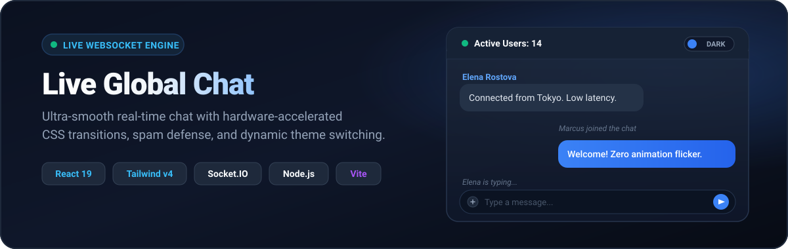
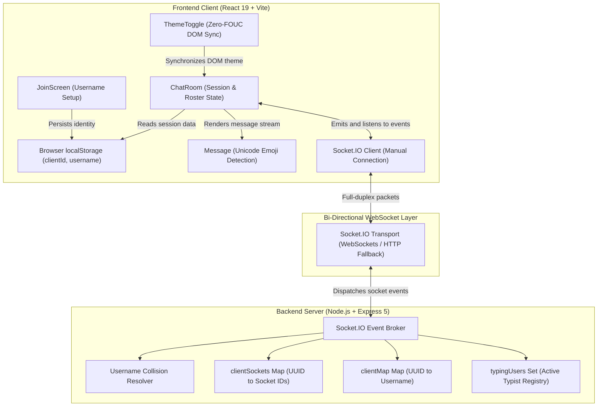

<p align="center">
  
</p>

<p align="center">
  <!-- <a href="https://live-global-chat-app.vercel.app/"></a> -->
  <a href="https://react.dev/"></a>
  <a href="https://vite.dev/"></a>
  <a href="https://tailwindcss.com/"></a>
  <a href="https://nodejs.org/"></a>
  <a href="https://expressjs.com/"></a>
  <a href="https://socket.io/"></a>
  <a href="./LICENSE"></a>
</p>

---

## Overview

Live Global Chat is a real-time messaging application built with React 19, Socket.IO 4, Tailwind CSS v4, and Node.js with Express 5. The platform allows users to join instantly without account creation, choose or update their username, see live active participants, and exchange messages with low-latency delivery across web browsers.

Under the hood, the system is designed around event-driven state coordination without database bottlenecks. Core engineering capabilities include persistent multi-tab session synchronization via client UUIDs, in-memory username collision resolution, a sliding-window spam limiter with lockout persistence, a rotational typing indicator carousel, viewport-aware auto-scrolling with an unread badge counter, and hardware-accelerated CSS transitions.

> **Live Demo:** [live-global-chat-app.vercel.app](https://live-global-chat-app.vercel.app/)

---

## System Architecture

The application implements a decoupled, event-driven client-server architecture. The React single-page frontend maintains a full-duplex WebSocket connection with an Express 5 backend broker via Socket.IO, falling back to HTTP long-polling when network restrictions apply.



---

## Key Features

### 1. Multi-Tab Client Session Synchronization
* Employs a persistent client identifier (`clientId`) generated via cryptographically secure v4 UUID and stored in browser `localStorage`.
* The backend tracks connections using a nested map structure: `clientSockets = new Map<clientId, Set<socketId>>` alongside `clientMap = new Map<clientId, username>`.
* Opening concurrent tabs or refreshing the window connects a new socket under the existing `clientId`, preventing duplicate entries in the active user roster and suppressing redundant join announcements.
* Disconnect events only broadcast a departure notice (`user-left`) when the final open tab for that client is closed (`set.size === 0`).

### 2. In-Memory Username Collision Resolution and Live Renaming
* Resolves naming conflicts automatically using an in-memory case-insensitive negotiation algorithm (`getUniqueUsername`).
* If a requested username is already active (for example, "Alex"), the server appends incremental numeric suffixes ("Alex-1", "Alex-2") before confirming the registration.
* Returning clients retain their reserved name upon reconnecting with the same `clientId`.
* Emits a `username-assigned` event back to the client, triggering non-blocking notifications via `react-hot-toast` if their username was adjusted.
* Supports live username changes from within the active chat room; updating a username propagates across all open tabs of that user and announces the update to the entire room via `username-changed`.

### 3. Sliding-Window Spam Defense and Lockout Timer
* Implements a rolling timestamp queue tracking outgoing messages over a 5-second interval.
* If a client dispatches more than 5 messages within 5 seconds, the application engages a 30-second penalty lockout.
* Lockout state and remaining time are persisted in `localStorage`, preventing users from bypassing the cooldown by reloading the browser.
* An animated visual countdown replaces the send controls, disabling the input field until the cooldown period expires.

### 4. Rotational Multi-User Typing Indicator
* The backend aggregates active typists in an ephemeral Set (`typingUsers`) and broadcasts updates via `update-typing-users`.
* When multiple users type simultaneously, the frontend cycles through typists using a 2-second interval carousel (`useEffect` timer).
* Prevents visual clutter and message container layout shifts during high-frequency group discussions.

### 5. Viewport-Aware Auto-Scroll with Unread Counter
* Evaluates container scroll geometry (`scrollHeight - scrollTop - clientHeight`) against a 200px threshold.
* When a user scrolls up to review message history, incoming messages increment an unread counter without pulling the viewport down.
* Displays a floating "New Messages" badge with the unread count; clicking the badge executes a smooth scroll to the newest message.
* When the viewport remains within 200px of the bottom, the container automatically scrolls down to display incoming messages in real time.

### 6. Slide-Over Active User Roster
* An off-canvas sidebar displays real-time connected participants with individual status indicators and avatars.
* Header counters reflect live connection totals, automatically updated via `active-users` broadcast events.

### 7. Audio Notification Feedback
* Plays a discreet chime (`notification.mp3`) through the HTML5 Audio API upon arrival of incoming messages from other participants.
* Audio playback is suppressed for outgoing messages sent by the local client to avoid redundant acoustic feedback.
* Accommodates browser autoplay permission policies with graceful fallback handling.

### 8. Adaptive Unicode Emoji Typography
* Scans message payloads using ES2018 Unicode property escapes (`\p{Extended_Pictographic}`).
* Messages composed solely of emojis are rendered without chat bubble backgrounds or borders.
* A single emoji scales to 72px (`text-7xl`), two to three emojis scale to 48px (`text-5xl`), and four or more scale to 36px (`text-4xl`).
* Messages with mixed alphanumeric text and emojis render with standard chat bubble typography.
* Integrated with `@joeattardi/emoji-button` popover picker dynamically synchronized with the current theme.

### 9. Zero-FOUC Tri-State Theme Engine
* Supports Light, Dark, and System preference options persisted in `localStorage`.
* Executes an inline, synchronous DOM script in `index.html` prior to React component hydration, eliminating Flash of Unstyled Content (FOUC).
* Dispatches a custom window event (`CustomEvent("themeChange")`) to notify external popovers, such as the `@joeattardi/emoji-button` picker, of active theme transitions.

### 10. Hardware-Accelerated CSS Transitions
* Interface animations (`viewFadeIn`, `joinCardEnter`, `messageEnter`, `quickFadeIn`) are built with native CSS keyframes.
* All keyframes operate exclusively on GPU compositor layers (`opacity` and `transform: translateY`) with `will-change: transform, opacity`.
* Eliminates runtime JavaScript animation overhead, avoids layout recalculations, and resolves React 19 hook lifecycle conflicts.

### 11. Deterministic Username Avatar Hashing
* Uses a bitwise character code hashing algorithm to map any username string to a consistent color index.
* Produces reproducible avatar accent colors across user lists, chat bubbles, and session reloads.

---

## WebSocket Event Protocol

The client and server communicate through structured Socket.IO events:

| Event | Direction | Payload | Description |
| :--- | :--- | :--- | :--- |
| `join` | Client to Server | `{ clientId: string, desiredName: string }` | Registers a client session with persistent UUID and requested username |
| `username-assigned` | Server to Client | `string` | Returns the negotiated, conflict-free username to the client |
| `user-joined` | Server to Broadcast | `string` | Announces a new user connection when their first tab opens |
| `active-users` | Server to Broadcast | `string[]` | Distributes deduplicated list of all currently active usernames |
| `change-username` | Client to Server | `{ clientId: string, oldName: string, newName: string }` | Requests username change propagated across all tabs of the client |
| `username-changed` | Server to Broadcast | `{ clientId: string, oldName: string, newName: string }` | Broadcasts username update to all active room participants |
| `typing` | Client to Server | None | Signals that the client has started typing |
| `stop-typing` | Client to Server | None | Signals that the client has stopped typing |
| `update-typing-users`| Server to Broadcast | `string[]` | Broadcasts updated array of usernames currently composing messages |
| `send-message` | Client to Server | `MessageObject` | Emits a new message object containing text, author, and timestamp |
| `receive-message` | Server to Broadcast | `MessageObject` | Relays the message object to all connected clients |
| `user-left` | Server to Broadcast | `string` | Announces a user departure when their final open tab disconnects |

---

## Tech Stack

| Layer | Technology | Version | Purpose |
| :--- | :--- | :--- | :--- |
| Frontend | React | 19.0.0 | Component hierarchy and application state |
| Frontend | Vite | 6.3.1 | Build tooling and hot module replacement |
| Frontend | Tailwind CSS | 4.1.4 | Utility-first responsive styling and CSS engine |
| Frontend | Socket.IO Client | 4.8.1 | Bi-directional WebSocket communication client |
| Frontend | @joeattardi/emoji-button | 4.6.4 | Popover emoji picker with dynamic theme binding |
| Frontend | react-hot-toast | 2.5.2 | Non-blocking toast notifications |
| Frontend | Lucide React & React Icons | 0.503.0 / 5.5.0 | SVG iconography primitives |
| Frontend | UUID | 11.1.0 | Cryptographic client identifier generation |
| Backend | Node.js | 18+ | Server JavaScript runtime |
| Backend | Express | 5.1.0 | HTTP server and middleware routing |
| Backend | Socket.IO Server | 4.8.1 | WebSocket broker and connection state management |
| Backend | CORS | 2.8.5 | Cross-Origin Resource Sharing middleware |
| Audio | HTML5 Audio API | Native | Audio chime playback for incoming messages |

---

## Repository Structure

```text
live-global-chat-app/
├── assets/
│   └── readme/
│       └── hero.svg            # Hero banner illustration
├── global-chat-server/
│   ├── index.js                # Express & Socket.IO server, presence & collision logic
│   ├── package.json            # Backend dependencies
│   └── package-lock.json
├── public/
│   ├── favicon.ico
│   └── notification.mp3        # Audio chime for incoming messages
├── src/
│   ├── components/
│   │   ├── ChatRoom.jsx        # Core chat interface, rate limiter, typing carousel
│   │   ├── JoinScreen.jsx      # Username setup and session initialization
│   │   ├── Message.jsx         # Message bubble with Unicode emoji scaling
│   │   └── ThemeToggle.jsx     # Light, dark, and system theme selector
│   ├── App.jsx                 # Top-level view routing and state
│   ├── index.css               # Tailwind CSS imports and GPU animation keyframes
│   ├── main.jsx                # Application entry point and root mounting
│   └── socket.js               # Socket.IO client instance and base URL config
├── .gitignore
├── eslint.config.js
├── index.html                  # Zero-FOUC theme initialization script
├── LICENSE
├── package.json                # Frontend dependencies
├── README.md
└── vite.config.js
```

---

## Environment Configuration

The application supports environment variables for configuring the backend server endpoint.

### Frontend Environment (`.env` in root directory)

```bash
# Backend WebSocket and API Server URL
# Defaults to http://localhost:5000 if omitted
VITE_API_BASE_URL=http://localhost:5000
```

### Backend Environment (`global-chat-server/.env`)

```bash
# Server Port (Defaults to 5000 if omitted)
PORT=5000
```

---

## Getting Started

### Prerequisites
* Node.js version 18.0.0 or higher
* npm version 9.0.0 or higher

### 1. Clone the Repository
```bash
git clone https://github.com/bilalzulfiqar-pk/live-global-chat-app.git
cd live-global-chat-app
```

### 2. Install Dependencies

Install frontend dependencies:
```bash
npm install
```

Install backend dependencies:
```bash
cd global-chat-server
npm install
cd ..
```

### 3. Start Development Servers

Start the backend Socket.IO server:
```bash
cd global-chat-server
npm run dev
```
The backend initializes on `http://localhost:5000`.

In a separate terminal window, start the frontend Vite development server:
```bash
npm run dev
```
The frontend will be accessible at `http://localhost:5173`.

### 4. Build for Production

To create an optimized production build of the frontend:
```bash
npm run build
```
The production bundle will be generated in the `dist/` directory.

---

## License

This project is licensed under the MIT License. See the [LICENSE](./LICENSE) file for complete details.
